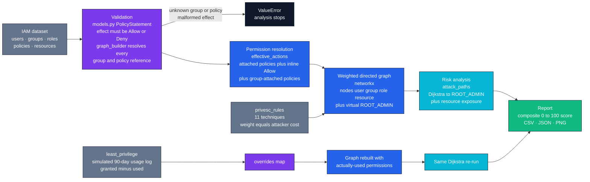
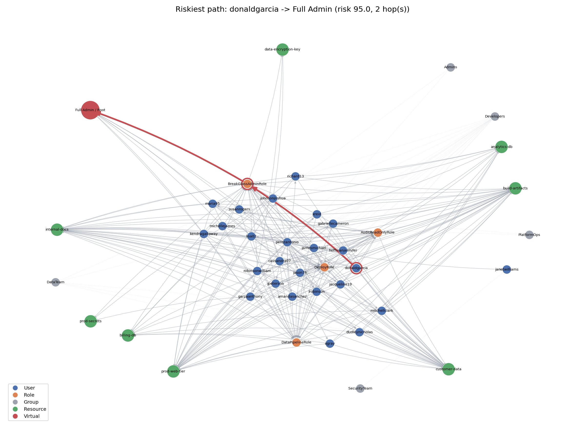
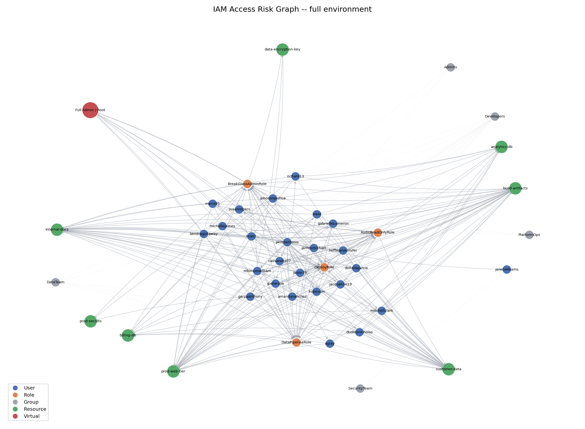

<div align="center">

# 🔐 Access Risk Analyzer

### Privilege-escalation path analysis over an IAM permission graph

**Models identities, groups, roles, policies and resources as a directed weighted graph, finds the
cheapest escalation chain from every identity to full admin, and then proves which permissions are
safe to remove by rebuilding the graph without them.
Malformed input and dangling relationships are rejected rather than silently lowering the risk score.**

[](https://github.com/ckvishwa/access-risk-analyzer/actions/workflows/ci.yml)
[](https://github.com/ckvishwa/access-risk-analyzer/actions/workflows/ci.yml)
[](pyproject.toml)
[](access_risk_analyzer/graph_builder.py)
[](access_risk_analyzer/privesc_rules.py)
[](#-known-limitations)

[Overview](#-overview) · [Problem](#-problem-statement) · [Features](#-capability-matrix) · [Architecture](#-system-architecture) · [How it works](#-how-it-works) · [Example](#-worked-example--synthetic-25-identity-environment) · [Input integrity](#-input-integrity) · [Testing](#-testing--quality-assurance) · [Quick start](#-quick-start) · [Limits](#-known-limitations)

</div>

---

## 📌 Overview

| | |
|---|---|
| **What it does** | Generates or loads an IAM environment, resolves each identity's effective permissions, builds a weighted directed graph where edges are known escalation techniques, runs Dijkstra from every identity to a virtual full-admin node, and scores each identity 0–100. Then it simulates a 90-day usage log, diffs granted against used actions, and **rebuilds the graph with the unused permissions removed** to measure what remediation would actually close. |
| **The problem it solves** | Policy linters evaluate permissions one at a time. `iam:PassRole` is not a finding. `ec2:RunInstances` is not a finding. Together they let an identity launch an instance with an admin role attached and harvest its credentials. **The chain is the finding, and a chain is a graph traversal, not a lint rule.** |
| **Who benefits** | Anyone who needs to know not just *who is over-permissioned* but *which specific grant to remove and what that removal buys*. |
| **Why the architecture** | The least-privilege engine is wired **into** the attack graph rather than bolted on as a separate report. Because `graph_builder` accepts an `overrides` map, the identical builder and the identical Dijkstra search produce both the "as granted" and the "as actually used" graphs — so the before/after comparison is an apples-to-apples measurement, not two different tools disagreeing. |

Same family of problem as PMapper or Cloudsplaining for AWS, or BloodHound for Active Directory —
built here end to end as a single Python pipeline.

> **The dataset is synthetic.** This has never been run against a live AWS, Azure or GCP account.
> See [Known Limitations](#-known-limitations) — the modelling simplifications matter for how the
> numbers should be read.

---

## 🎯 Problem Statement

```
A developer holds iam:PassRole and ec2:RunInstances.
  - iam:PassRole alone        -> not a finding
  - ec2:RunInstances alone    -> not a finding
  - both, with an unscoped PassRole target -> launch an instance with an
    admin role attached, then read its credentials from instance metadata.
```

No single permission looks like a problem. A per-policy audit passes. Only a traversal over the
*combination* finds it, and only a weighted traversal ranks it against the other 18 ways into admin
in the same environment.

A second, subtler failure mode motivated the input-integrity work in
[PR #1](https://github.com/ckvishwa/access-risk-analyzer/pull/1): **a risk analyser that fails
quietly is worse than one that crashes.** A mistyped group name or an `"allow"` effect that should
have been `"Allow"` used to make a grant disappear from the model — and an identity that was
effectively an admin was reported as having *no path to admin at all*. A security tool that
under-reports is actively harmful, because it is believed.

---

## ✨ Capability Matrix

| Capability | Verified behaviour | Status |
|---|---|---|
| Identity and permission graph modelling | Users, groups, roles, managed and inline policies, resources, plus a virtual `ROOT_ADMIN` node | **Implemented** |
| Effective permission calculation | Union of attached policies, inline `Allow` statements, and group-attached policies, per identity | **Implemented** |
| Privilege-escalation path analysis | 11 escalation techniques as weighted edges; Dijkstra finds the cheapest chain to admin | **Implemented** |
| Resource exposure ("blast radius") | Separate analysis: how directly each identity reaches a `sensitivity=high` resource | **Implemented** |
| Least-privilege analysis | Simulated 90-day usage log; granted-vs-used diff; flags unused permissions that are *specifically* ingredients of a known escalation technique | **Implemented** |
| Remediation impact measurement | Graph rebuilt with trimmed permissions via `overrides`; same Dijkstra re-run | **Implemented** |
| Composite risk scoring | 0–100 per identity: escalation risk + resource exposure + least-privilege gap | **Implemented** |
| **Malformed input rejection** | A statement effect other than `Allow`/`Deny` raises at construction | **Implemented + regression-tested** |
| **Dangling relationship validation** | An unknown group membership or unknown policy reference raises instead of being skipped | **Implemented + regression-tested** |
| Risk report generation | CSV, JSON, and `matplotlib` renderings of the full graph and the single riskiest path | **Implemented** |
| MITRE ATT&CK (Cloud) mapping | Every technique carries an `attack_id` and technique name | **Implemented** |
| Real cloud ingestion (`get-account-authorization-details`) | — | **Planned — data-layer swap only** |
| Real usage data (Access Advisor / CloudTrail) | — | **Planned** — the log is simulated today |
| Resource-level ARN scoping | Simplified to service level | **Not implemented** |
| Deny-statement evaluation, SCPs, permission boundaries, condition keys | — | **Not implemented** |

---

## 🧱 System Architecture



The `overrides` map is the whole trick: one builder, one search, two permission sets.

---

## 🔄 How It Works

| # | Stage | Module | What happens |
|---|---|---|---|
| 1 | **Generate or load** | [`data_generator.py`](access_risk_analyzer/data_generator.py) | A synthetic but structurally realistic IAM environment via `Faker`. A configurable fraction of identities receive an extra "convenience" policy layered on normal access — modelling permission creep rather than hand-placed scenario flags. **Deterministic given a seed.** |
| 2 | **Validate** | [`models.py`](access_risk_analyzer/models.py), [`graph_builder.py`](access_risk_analyzer/graph_builder.py) | A `PolicyStatement` effect must be exactly `Allow` or `Deny`. Every group membership and policy reference must resolve. Anything else raises — see [Input integrity](#-input-integrity). |
| 3 | **Resolve permissions** | `effective_actions()` | Union of each identity's attached policies, inline `Allow` statements, and the policies attached to its groups. |
| 4 | **Build the graph** | [`graph_builder.py`](access_risk_analyzer/graph_builder.py) | A directed weighted `networkx` graph. An edge exists where an identity's effective actions satisfy an escalation rule; **edge weight encodes how cheap and reliable that technique is for an attacker — lower means more dangerous.** Membership edges carry weight `0.01` and are cosmetic. |
| 5 | **Find paths** | [`attack_paths.py`](access_risk_analyzer/attack_paths.py) | `find_privesc_paths_to_admin` — cheapest escalation chain from each identity to the virtual admin node. `find_resource_exposure_paths` — a deliberately separate blast-radius metric: how directly an identity reaches a `sensitivity=high` resource, independent of admin takeover. |
| 6 | **Least privilege** | [`least_privilege.py`](access_risk_analyzer/least_privilege.py) | Simulates a 90-day usage log per identity, diffs granted against used actions, and flags unused permissions that are ingredients of a known escalation technique. An identity holding a literal `AdministratorAccess` wildcard is **called out rather than scored**, because a wildcard cannot be meaningfully diffed against a usage log. |
| 7 | **Measure remediation** | `remediation_impact()` | Rebuilds the graph through `overrides` using only actually-used permissions, re-runs the same search, and reports how many identities still reach admin. |
| 8 | **Report** | [`risk_report.py`](access_risk_analyzer/risk_report.py), [`visualize.py`](access_risk_analyzer/visualize.py) | Composite 0–100 score per identity (escalation risk + resource exposure + least-privilege gap), CSV and JSON output, and graph renderings. |

### Escalation techniques — 11 rules, 4 ATT&CK (Cloud) techniques

From [`privesc_rules.py`](access_risk_analyzer/privesc_rules.py):

| Rule | ATT&CK ID | Technique |
|---|---|---|
| `create_access_key_for_user` | T1098.001 | Account Manipulation: Additional Cloud Credentials |
| `update_login_profile` | T1098.001 | Account Manipulation: Additional Cloud Credentials |
| `attach_user_policy` | T1098.003 | Account Manipulation: Additional Cloud Roles |
| `attach_group_policy` | T1098.003 | Account Manipulation: Additional Cloud Roles |
| `put_user_policy` | T1098.003 | Account Manipulation: Additional Cloud Roles |
| `create_policy_version` | T1098.003 | Account Manipulation: Additional Cloud Roles |
| `update_assume_role_policy` | T1098.003 | Account Manipulation: Additional Cloud Roles |
| `add_user_to_group` | T1098.003 | Account Manipulation: Additional Cloud Roles |
| `pass_role_ec2` | T1548.005 | Abuse Elevation Control Mechanism: Temporary Elevated Cloud Access |
| `pass_role_lambda` | T1548.005 | Abuse Elevation Control Mechanism: Temporary Elevated Cloud Access |
| `assume_role_via_trust` | T1078.004 | Valid Accounts: Cloud Accounts |

Same class of techniques documented by Rhino Security Labs' AWS IAM privilege-escalation research.

---

## 📊 Worked Example — Synthetic 25-Identity Environment

> **Clearly labelled: this is a synthetic, `Faker`-generated environment, not a real cloud account.**
> Every number below is reproducible exactly, because the generator is deterministic given a seed:
>
> ```bash
> python -m access_risk_analyzer.main --num-users 25 --seed 42 --output-dir output
> ```

### Environment summary — `risk_summary.json`

| Metric | Value |
|---|---|
| Identities | 25 |
| Average composite risk score | 66.2 |
| Identities with an escalation path to full admin | **19 / 25** |
| High-risk identities | 17 |
| High-risk identities without MFA | **5** |
| Highest composite score | 89.2 (`johnsonjoshua`) |

### Remediation impact — `remediation_impact`

| Metric | Before | After |
|---|---|---|
| Identities with a path to full admin | **19** | **10** |
| Distinct admin paths found | 24 | 23 |
| Average risk of *remaining* admin paths | 94.3 | 95.0 |

**Removing the unused permissions the least-privilege engine flagged closes the escalation path for
9 of the 19 affected identities.**

Two things in that table need explaining rather than hiding:

- **The average severity goes *up*, from 94.3 to 95.0.** That is survivorship bias, by design.
  Trimming removes the *cheapest* paths first — that is exactly what low edge weight means — so the
  mean severity of whatever survives can tick up even as the count drops. The remediation worked;
  what remains is a smaller and genuinely harder subset.
- **Identities dropped 19 → 10, but distinct paths only dropped 24 → 23.** These count different
  things. The path count is the number of distinct cheapest-chains the search returns across the
  environment; several identities funnel through shared role hops, so removing an identity's
  *access* to a chain does not remove the chain. **The identity count is the meaningful remediation
  metric here**; the path count is reported for completeness, not as a 1-of-24 improvement claim.

### Visualisations



*A path from a seeded run: `donaldgarcia → BreakGlassAdminRole → Full Admin` — 2 hops, risk 95/100,
driven by an unscoped `PassRole` grant. (This committed asset comes from an earlier seeded run; the
top-scoring identity under `--seed 42` is `johnsonjoshua`.)*



*Blue = users, orange = roles, green = resources, grey = groups, red = the virtual full-admin node.
The density is itself the finding: this many edges converging on one red node is what an auditor is
looking for.*

---

## 🔒 Input Integrity

Fixed in [PR #1](https://github.com/ckvishwa/access-risk-analyzer/pull/1), with regression tests in
[`tests/test_input_integrity.py`](tests/test_input_integrity.py). Each test fails against the
pre-fix code.

| Weakness | Before | After |
|---|---|---|
| **Dangling group membership** | `next((g for g in dataset.groups if g.name == gname), None)` returned `None` for a mistyped group and the membership was **silently skipped**. Reproduced: user `alice` is a member of `"admins"` (correct name `"Admins"`), is effectively an admin, and was reported with **no path to admin at all** | Raises `ValueError: user 'u1' is a member of unknown group 'admins'` |
| **Dangling policy reference** | `dataset.policies[pid]` on a missing policy — an unclear failure at best | Raises `ValueError: ... references unknown policy 'p-missing'`, naming the owning user, group or role |
| **Malformed statement effect** | IAM effects are case-sensitive. Any value other than `Allow` was treated as "not Allow", so `"allow"`, `"ALLOW"` or `"Permit"` made a **wildcard admin grant vanish from every risk result** | `PolicyStatement.__post_init__` rejects anything that is not exactly `Allow` or `Deny` |

The design principle: **a security analyser must fail loudly rather than report a lower risk.** An
exception is a bug report; a silently dropped permission is a false assurance.

---

## 🧪 Testing & Quality Assurance

| Metric | Value |
|---|---|
| Tests | **19 passing** on hosted CI (15 test functions; parametrisation expands them to 19 cases) |
| Python matrix | **3.10** and **3.12** |
| Workflow | [`ci.yml`](.github/workflows/ci.yml), triggered on every push to `main` and every pull request |

| Module | Covers |
|---|---|
| [`test_smoke.py`](tests/test_smoke.py) | Pipeline self-consistency: every reported path is actually walkable in the graph; remediation never *increases* the number of admin-reachable identities in the tested scenario; the report's row count matches the identity count; the dataset is deterministic given a seed |
| [`test_input_integrity.py`](tests/test_input_integrity.py) | **Security regressions** — a resolvable group admin *is* reported; an unknown group membership, unknown attached policy and unknown group policy each raise; `"allow"`, `"ALLOW"`, `"Permit"`, `""` and `None` effects are all rejected; `Deny` is still accepted |

**What the tests do not do:** they make no claim that the findings are *realistic*. That is a
judgement call about the synthetic generator, not something a test can assert. They check that the
pipeline's internal logic is consistent and that malformed input fails closed.

```bash
python -m pip install -e ".[dev]"
python -m pytest -q
```

---

## 🚀 Quick Start

```bash
# Recommended: editable install, no sys.path juggling
python -m pip install -e ".[dev]"
python -m access_risk_analyzer.main --num-users 25 --seed 42 --output-dir output
```

Or without an editable install:

```bash
pip install -r requirements.txt
python -m access_risk_analyzer.main --num-users 25 --seed 42 --output-dir output
```

Outputs in `output/`:

| File | Contents |
|---|---|
| `iam_data.json` | The generated environment |
| `attack_paths.json` | Every escalation-to-admin and resource-exposure path, with the exact technique chain and ATT&CK IDs |
| `least_privilege_recommendations.json` | Per-identity trimmed-policy recommendations |
| `risk_report.csv` / `risk_summary.json` | Composite scoring and the remediation-impact block |
| `attack_graph.png` / `top_risk_path.png` | Visualisations |

> **Verified:** the command above was run with Python 3.12 and reproduced every figure in
> [Worked example](#-worked-example--synthetic-25-identity-environment) exactly.
> No cloud account, credentials, API keys or external services are required.

---

## 📂 Repository Structure

```text
access-risk-analyzer/
├── access_risk_analyzer/
│   ├── models.py          # IAMDataset, IAMUser, IAMGroup, IAMRole, Policy,
│   │                      # PolicyStatement (effect validated at construction)
│   ├── data_generator.py  # synthetic environment via Faker, seed-deterministic
│   ├── privesc_rules.py   # 11 escalation techniques + ATT&CK mapping + weights
│   ├── graph_builder.py   # effective_actions(), weighted graph, overrides map
│   ├── attack_paths.py    # Dijkstra to admin + resource-exposure analysis
│   ├── least_privilege.py # usage diff, recommendations, remediation_impact()
│   ├── risk_report.py     # composite 0-100 scoring, CSV + JSON
│   ├── visualize.py       # networkx + matplotlib renderings
│   └── main.py            # CLI entry point
├── tests/
│   ├── test_smoke.py           # pipeline self-consistency
│   └── test_input_integrity.py # input-integrity regressions
├── assets/                     # committed example renderings
├── risk_report.csv             # committed example report
├── pyproject.toml · requirements.txt · requirements-dev.txt · conftest.py
└── .github/workflows/ci.yml
```

---

## 🧠 Engineering Decisions

| Decision | Reasoning | Rejected alternative |
|---|---|---|
| Model escalation as a **weighted** graph | Ranking matters more than enumeration — an auditor needs the cheapest path first, and weight is what makes "cheapest" meaningful | An unweighted reachability check, which finds the same 19 identities but cannot prioritise them |
| A virtual `ROOT_ADMIN` node | Turns "can this identity become admin?" into a single-target shortest-path query instead of a special case per admin principal | Checking each admin role separately |
| Least-privilege engine wired into the graph via `overrides` | The same builder and the same search produce both graphs, so before/after is a true comparison | A standalone least-privilege report that cannot say what its recommendations would close |
| Raise on a dangling reference instead of skipping it | A skipped membership produces a *lower* risk score — the most dangerous possible failure for this tool | Logging a warning and continuing |
| Validate the effect in `__post_init__` | Rejects the bad value at construction, so no downstream code can observe a half-valid statement | Checking the effect at each comparison site |
| Flag `AdministratorAccess` wildcards instead of scoring them | A wildcard cannot be diffed against a usage log, so any number would be invented | Expanding the wildcard to a concrete action list |
| Keep resource exposure as a separate metric | Admin takeover and data reach are different risks; collapsing them hides an identity that cannot reach admin but sits next to the customer database | One blended score |
| Service-level rather than ARN-level scoping | Keeps the graph layer honest about what the synthetic data can support | Fabricating ARN-level grants the generator cannot model realistically |

---

## 🚧 Known Limitations

- **Synthetic dataset only.** Never run against a live AWS, Azure or GCP account. Wiring
  `data_generator.py`'s output format to a real `aws iam get-account-authorization-details` export
  would be a **data-layer swap** — the graph and analysis layers would not change — but it has not
  been done.
- **The 90-day usage log is simulated** (a random subset of granted actions), not an Access Advisor
  or CloudTrail export. The diffing and recommendation *logic* is the deliverable.
- **Resource scoping is simplified to service level.** `s3:*` grants access to "an S3 bucket", not
  to one specific ARN. Real environments are usually **more** constrained than this model, so treat
  absolute path counts as illustrative of the technique, **not as a literal vulnerability count**.
- **No `Deny` evaluation.** A `Deny` statement is validated and stored, but `Policy.actions()`
  collects `Allow` statements only, so a `Deny` never subtracts from effective permissions. Real IAM
  is deny-by-default with explicit deny winning; this model unions `Allow` grants, so it
  **over-estimates** effective access.
- **No SCPs, permission boundaries, session policies or condition keys.** A grant that real IAM
  would gate behind a condition is treated here as unconditional.
- **Role chaining is shallow.** The graph models assuming a role via a permissive trust policy
  (`assume_role_via_trust`, T1078.004) and rewriting a trust policy
  (`update_assume_role_policy`), but it does **not** model full multi-hop role-chaining semantics:
  session duration limits, `sts:AssumeRole` chains across accounts, external-ID requirements, or
  the way a chained session's permissions are the *intersection* of the role and any session
  policy. Multi-hop paths through roles are therefore **optimistic** — the graph may show a chain
  that real STS would refuse.
- **Trust relationships are modelled as a permission edge, not as a policy document.** A real trust
  policy names principals, conditions and external IDs; here the decision collapses to "is this
  trust policy overly permissive". Cross-account trust is not modelled at all.
- **No AWS IAM semantic completeness is claimed.** This is a graph-analysis exercise over a model of
  IAM, not an IAM policy evaluator.
- **`effective_actions` resolves users and roles, not group-of-group nesting.**
- **The composite 0–100 score is a project-defined heuristic**, not an industry-standard severity
  scale, and is comparable only within a single run.
- **The tests do not validate realism** — only internal consistency and fail-closed behaviour.

---

## 🧭 Roadmap

Planned, not implemented.

| Planned | Why |
|---|---|
| Load real `get-account-authorization-details` exports | Turns every number here into a measurement; graph and analysis layers need no change |
| Ingest real Access Advisor / CloudTrail usage | Replaces the simulated usage log, making recommendations actionable |
| Evaluate explicit `Deny`, SCPs and permission boundaries | Removes the current over-estimate of effective access |
| Full multi-hop role-chaining with STS semantics | Closes the optimistic-path gap described above |
| ARN-level resource scoping | Makes path counts meaningful rather than illustrative |
| Condition-key awareness | A conditional grant is not an unconditional one |
| Azure and GCP data loaders | The graph layer is provider-agnostic already |

---

## 🧰 Stack

Python 3.10+ · `networkx` (graph construction and Dijkstra shortest paths) · `matplotlib`
(visualisation) · `Faker` (synthetic identity data) · `pytest`.
No external services or API keys required.

---

## 👨‍💻 Author

**Vishva Teja Chikoti** — Cybersecurity · Security Engineering · QA Automation
M.S. Cybersecurity & Networks, University of New Haven (Aug 2023 – Dec 2025) · CompTIA Security+

[](https://github.com/ckvishwa)
[](https://linkedin.com/in/vishvack)
[](mailto:vishvatejack@gmail.com)
